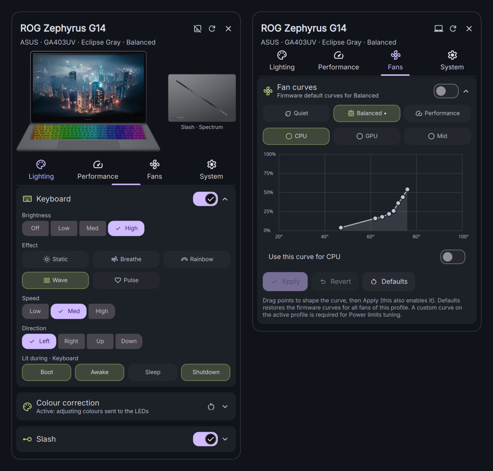

# ROG Control for DankMaterialShell

Everything `asusctl` can do on an ASUS ROG laptop, in one DankBar widget, driven
directly over asusd's D-Bus API. The panel only shows what your hardware reports,
so it adapts to your model.



## Features

- **Live laptop illustration**: an original vector drawing in your chassis
  colour, with your current wallpaper on the screen, the keyboard glowing with the
  real Aura effect, and the Slash ledbar animating on the lid.
- **Lighting**
  - Keyboard: on/off, brightness, every supported effect, one or two colours
    (picker + swatches), speed, direction, per-zone power states (boot / awake /
    sleep / shutdown).
  - **LED colour correction**: saturation boost + gamma, applied only to what is
    sent to the LEDs, so they match the colour you picked (RGB LEDs look washed
    out otherwise). Shows a picked → sent preview.
  - **Follow theme**: the keyboard follows the DMS / matugen accent colour.
  - Slash ledbar: enable, all 16 animations, brightness, interval, and when to
    show it (boot, shutdown, sleep, lid closed, battery, low-battery warning).
- **Performance**: active profile, automatic AC / battery profiles, per-profile
  CPU energy preference, nvidia-powerd on battery, and power-limit tuning
  (CPU PL1–PL3, GPU TGP / Dynamic Boost / temperature target).
- **Fans**: per-profile, per-fan (CPU / GPU / Mid) curve editor with draggable
  points, per-fan enable, reset to firmware defaults.
- **System**: charge limit, one-shot full charge, power source, GPU MUX
  (Ultimate / Optimus), dGPU disable (Eco), boot sound, pending-reboot banner,
  and any other asus-armoury firmware attribute your model exposes.
- Collapsible sections, live updates (Fn keys and `asusctl` changes show up
  instantly), and a Control Center tile for the keyboard light.

**Bar icon**: profile + keyboard, tinted with the effect colour. Scroll changes
keyboard brightness; right-click toggles the keyboard light or cycles the profile.

## Install

```sh
dms plugins install rogControl
```

or clone this repo into `~/.config/DankMaterialShell/plugins/`, then enable
**ROG Control** in DMS settings and add it to a bar section.

Open the panel from a keybind (Hyprland example):

```
bind = SUPER, F1, exec, dms ipc call widget toggle rogControl
```

## Requirements

- `asusd` running (from [asusctl](https://gitlab.com/asus-linux/asusctl), 6.x)
- `busctl` (systemd), `gdbus` (glib2), `jq`

## Notes

- asusd only allows power-limit tuning once a custom fan curve is enabled for
  the active profile; the UI follows the same rule.
- GPU MUX / dGPU switches ask for a second tap to confirm; MUX changes need a reboot.
- Chassis colour isn't reported by firmware; pick it in System → This laptop.
- Settings live in asusd itself, so they survive reboots and apply without this
  plugin; the plugin only stores its own UI preferences.
- Not implemented (no hardware to test against): AniMe Matrix, Ally / SCSI LEDs,
  XG Mobile LED, ScreenPad. The rest works on those models.
- Tested on a ROG Zephyrus G14 (GA403UV), asusctl 6.5.0, DMS 1.6.

## Disclaimer

Community project, not affiliated with or endorsed by ASUSTeK Computer Inc.
"ASUS", "ROG" and "Zephyrus" are trademarks of their respective owners. The laptop
illustration is an original drawing; no ASUS images or logos are included.

## License

MIT
